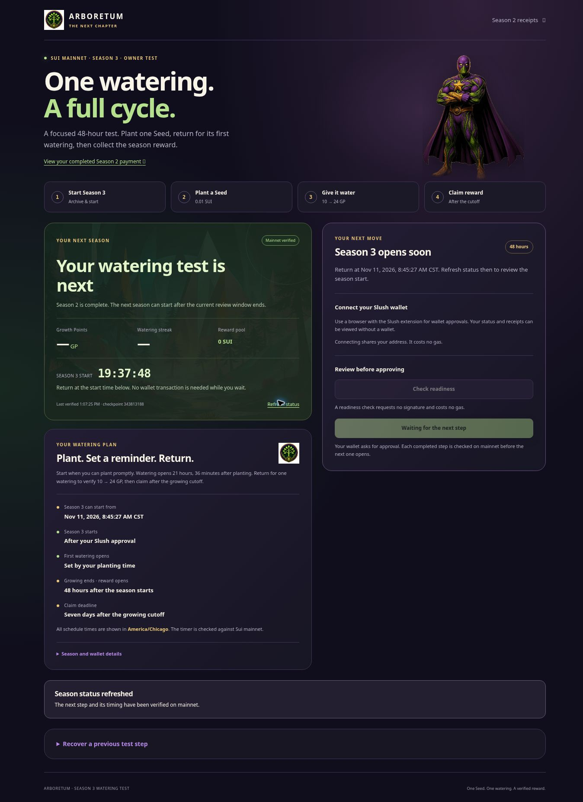

# Season 3 watering page: published and verified

The separate [Season 3 owner test](https://www.treegrow.xyz/admin/season-three/)
was published on **November 10, 2026, at 19:06:21 UTC**. Publication prepared
the page; it did not start a season or submit a Sui transaction.

| Release item | Verified value |
| --- | --- |
| Target site | `d425445d-4980-49be-8ab2-12e7527ba281` / `arboretum-preview` |
| Published deployment | `6af36b1211851adcba7aa254` |
| Saved source | [`5d17306758518579bf523ab8a7f9e8cb198a9fe8`](https://github.com/TheCryptoArborist/arboretum/commit/5d17306758518579bf523ab8a7f9e8cb198a9fe8) |
| Source tree | `a17cff6a8a442d1518bf69331fd600731868e3dd` |
| Previous published deployment | `6af09274b50143d105dbb63a` |
| Existing application files retained byte for byte | 106 |
| Added application files | 3 |
| Complete deployed application inventory | 109 |
| Authenticated raw deployed asset matches | 109 |
| Anonymous HTTP checks | 27 passed |
| New application tests | 152 passed; 0 failed or skipped |
| Release helper tests | 11 passed |

The exact saved source passed both required **Settlement app integration
review** runs: [push 42881396425](https://github.com/TheCryptoArborist/arboretum/actions/runs/42881396425)
and [pull request 42881414707](https://github.com/TheCryptoArborist/arboretum/actions/runs/42881414707).
The production build was submitted once using the durable source-build journal.

The existing calendar function, both edge functions, absence of scheduled
functions, dependency locks, and backend source were preserved. The original
site remains on deployment `6abe81174b61a8e3dd53b333`.

## Live browser result

The published page displays **Mainnet verified**, **Your watering test is
next**, and **Season 3 opens soon**. Its readiness and submission buttons are
disabled while the ordinary reset window is closed.

An explicit status refresh advanced the displayed checkpoint from **343813117**
to **343813188**. The page reported its latest verified time as **1:07:25 PM
America/Chicago**. The displayed earliest start is **November 11, 2026,
8:45:27 AM CST**; the exact protocol boundary is `1794408327707` milliseconds,
or **8:45:27.707 AM CST**.

For a practical check-in time, return **Wednesday, November 11, at 8:46 AM
Central**. Refresh status, connect the owner account in Slush, review Start
Season 3, and personally approve the transaction. Plant promptly afterward.
The new 48-hour growing window starts at the actual successful season-start
transaction. Watering opens 21 hours and 36 minutes after actual planting.

## Evidence

- [`submission.json`](submission.json): source, archive hash, single POST, and returned deployment.
- [`ci.json`](ci.json): both required exact-source successes and separate legacy workflow failures.
- [`preflight-before-submit.json`](preflight-before-submit.json): authenticated target and preservation checks before submission.
- [`candidate.json`](candidate.json): exact source and the complete application file hashes.
- [`hosted-assets.json`](hosted-assets.json): all raw deployed assets, inventory, functions, and both site identities.
- [`hosted-http.json`](hosted-http.json): direct GET/HEAD behavior, headers, retained entrances, rejected writes, calendar, and public pages.
- [`browser.json`](browser.json) and [`season-three-live-ax.txt`](season-three-live-ax.txt): observed page state and refresh.
- [`../local/summary.json`](../local/summary.json): local tests, protected build, and preservation.
- [`../live-readonly/summary.json`](../live-readonly/summary.json): independent Season 2 claim validation and live waiting state.

## Limits and remaining live work

No wallet was connected, no signature was requested, and no Sui transaction
was submitted during this release. Slush is not installed in the verification
browser, so wallet execution remains the owner's action. Season 3 starting,
planting, real watering from 10 to 24 GP, receipt persistence after refresh,
calendar download from a live planting, and the subsequent 24-GP claim remain
to be completed.

The new page only reports the focused watering test complete after the
corresponding verified mainnet claim. A 10-GP claim remains possible if
watering is missed, but does not satisfy that test.

Five existing workflows outside this release gate reported failures:
Partner chest preview, Economy accounting review, Reward-first production
release, Reward-first preview, and Garden season status. Their exact run links
are retained in `ci.json`; this record does not claim that every repository
workflow passed. Broader public-launch and multiple-wallet reward testing
remain separate work.
