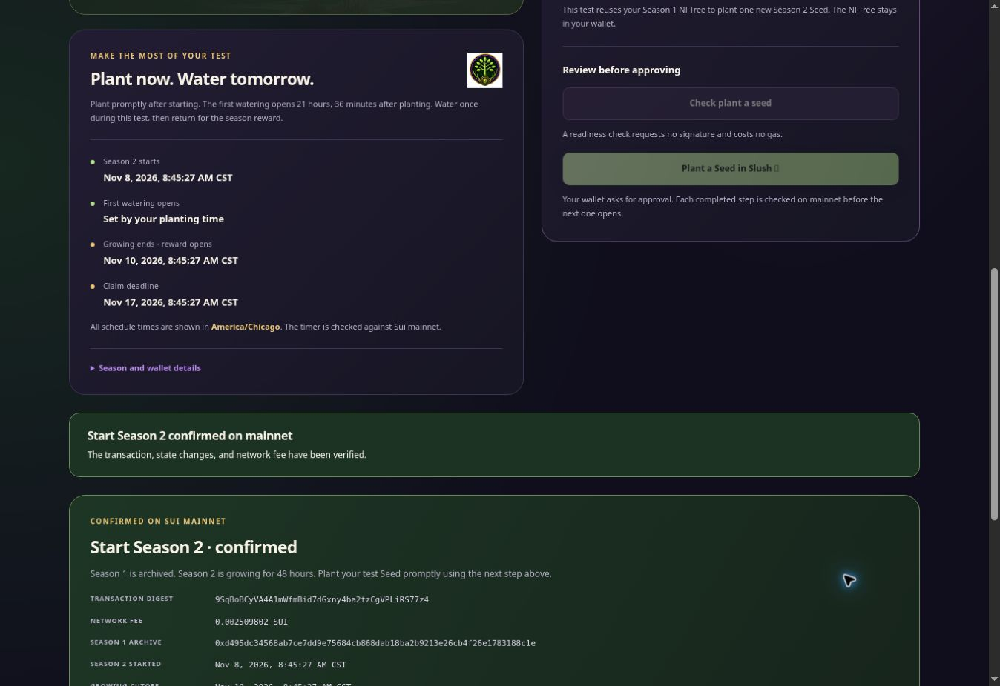

# Published Season 2 planting correction

The correction is live at <https://www.treegrow.xyz/admin/season-two/>.
Netlify published it on **November 8, 2026, at 15:17:26 UTC / 9:17:26 AM
America/Chicago**. The deployment was verified after publication.

| Release item | Verified value |
| --- | --- |
| Site | `d425445d-4980-49be-8ab2-12e7527ba281` — `arboretum-preview` |
| Source commit | `1062f33c881939de53ca10529ef81b5d8dbabc89` |
| Source tree | `84bf53034518c3e749411fb8a2fea948c3b4c8c3` |
| Deployment | `6af09274b50143d105dbb63a` |
| Build | `6af09273b50143d105dbb638` |
| Previous published deployment | `6af08867e808541bad23b5b2` |
| Changed runtime file | `admin/season-two/admin.mjs` |
| Other runtime files | All 105 byte-identical |
| Bundle SHA256 | `737b7c04ec073fe1753cbbb63356856c6e94609f02e7fb8a563ede2ee23ebb2a` |
| Source archive SHA256 | `fabf115492dc5ee0726fa6a5bed956ed9f28488f4779a2ad47fbd85d2992848a` |
| Source configuration | Unchanged `netlify.toml` |

## What was verified

The fix accepts the explicitly unchanged 10-GP field in the first Season 2
planting, while still verifying its exact historical identity and every
required changed field. The [local verification record](../README.md) contains
the cause, proof requirements and live unsigned simulation. All 184 local
tests/checks in the three recorded test suites passed, along with lint and
the protected production build.

Both required **Settlement app integration review** runs passed for this
exact source commit:

- [Push run 42493848886](https://github.com/TheCryptoArborist/arboretum/actions/runs/42493848886).
- [Pull-request run 42493855420](https://github.com/TheCryptoArborist/arboretum/actions/runs/42493855420).

The CI evidence bytes were pinned before the sole source-build submission.
The source ZIP was durably journaled outside the repository before the POST;
the API response identified the build and deployment. No resubmission was
needed. [`submission.json`](submission.json), [`candidate.json`](candidate.json)
and [`ci.json`](ci.json) retain that exact binding.

Authenticated verification matched all **106 file inventory entries and 106
raw assets** against the tested build. Only the Season 2 JavaScript bundle
changed. The `calendar-reminder` function retained digest
`e11353817de886625c0f037e5b341f1506b51b3477a227281527bd9bf496de98` and its
runtime configuration. Both edge functions, `public-player-guide` and
`tester-gate`, and the empty schedule list were preserved. The original
`arboretum-sui-forest` site remained on `6abe81174b61a8e3dd53b333`.
See [`hosted-assets.json`](hosted-assets.json).

All **24 public HTTP checks passed**, including anonymous Season 2 GET/HEAD,
fixed entrance redirects, invalid destination fallbacks, rejected direct
writes, calendar download and retained public pages. No tester access code
was reintroduced. See [`hosted-http.json`](hosted-http.json).

## Live browser result

After reloading the deployed page, the browser displayed **Mainnet verified**.
Read-only recovery of actual rollover transaction
`9SqBoBCyVA4A1mWfmBid7dGxny4ba2tzCgVPLiRS77z4` succeeded, showing:

- **Start Season 2 confirmed on mainnet**.
- **Your new season is growing**, with **Plant a Seed** as the next step.
- NFTree #4704 as the available fixed NFTree.
- The original growing cutoff, **November 10, 2026, at 8:45:27 AM CST**.

The verification browser has no Slush extension. Its planting controls remain
disabled until an eligible wallet is connected; that is expected. The separate
[live unsigned mainnet preview](../mainnet/summary.json) verified the corrected
planting check. An actual Season 2 planting and Slush approval remain the
owner's next action. No wallet was connected, no signature requested and no
Sui transaction submitted during deployment or browser verification.

[`browser-verification.json`](browser-verification.json) records the observed
checkpoints, exact displayed values, screenshot hash and limits. Mobile visual
inspection was not performed; HTML and CSS were unchanged in this correction.

## CI scope and retained history

The two required integration runs passed. Five separate non-gating workflows
reported failures on this source: Reward-first preview, Reward-first production
release, Garden season status, Partner chest preview and Economy accounting
review. Those workflows also failed for the prior release; this record does
not report them as passing or claim to fix them.

The original Season 2 publication record and the prepublication local evidence
remain intact. The exact deployed application source is the commit listed
above; the later evidence-only commit records these completed checks and does
not cause another Netlify publication.
