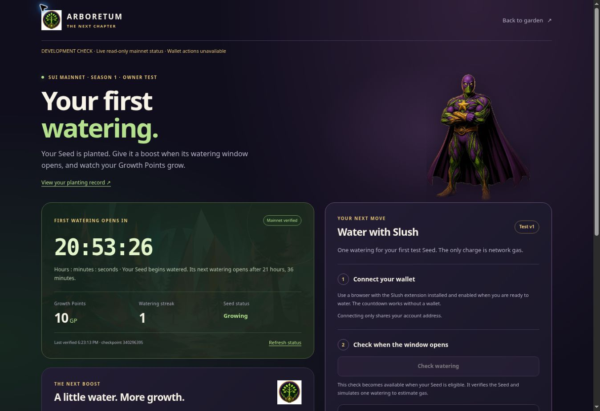

# First-watering release verification

Published source: `7506a3778f35a74c4889e34a87dd0a547d886a0c`  
Tested source tree: `bcb418a8f71833e41a798996eaa0b7c66407dcbd`  
Netlify deployment: `6ae678179e4a049e68a01cae`  
Published: **October 31, 2026 at 6:22:17 p.m. CDT** (`2026-10-31T23:22:17.269Z`)  
Live entrance: <https://www.treegrow.xyz/tester-access?next=watering-test>

## Verified result

- 42 focused watering tests pass: 22 core verification tests and 20 controller tests.
- The retained local required checks and protected build pass; see `local-validation.json`.
- Both exact-source **Settlement app integration review** CI runs pass: [pull request](https://github.com/TheCryptoArborist/arboretum/actions/runs/41252145719) and [push](https://github.com/TheCryptoArborist/arboretum/actions/runs/41252140066).
- All 100 published application files match local file hashes and lengths. Thirty-four critical deployed files also match their fetched raw bytes.
- All 97 previous application paths remain. Ninety-six are byte-identical; the planting HTML gains a link to watering. Three watering runtime files are added.
- The dedicated site, calendar function digest and runtime, two edge function names, empty scheduled-job list and original site's published deployment are verified.
- Six live anonymous HTTP checks pass. Protected watering documents return to the fixed watering tester entrance; its CSS and JavaScript reject anonymous access.
- The live browser entrance visibly shows **Continue to first watering**. Desktop and narrow mobile layout checks pass in the local read-only harness. The final narrow check has equal document and viewport widths of 375 pixels.

## Mainnet observation and limits

The actual planting digest is `FM5QeE2Eb2tQwQeSsTKz8s4a81mZVqde5kF2HAEmyisB`.
The Seed remains at **10 GP**, streak **1**, and growing. The layout capture below
read mainnet checkpoint **340296395** at approximately **6:23:13 p.m. CDT**.
It uses the deployed page layout with a disposable development harness, an
explicit development banner, and wallet actions unavailable. It is not an
authenticated live-site or real-wallet execution screenshot.

The first eligible watering is **November 1, 2026 at 2:16:41.252 p.m. CST**,
before growing closes at **3:57:28.277 p.m. CST**. The expected unchanged-Seed
result is 24 GP and streak 2, with network gas only. The checked early unsigned
mainnet simulation correctly rejects the action with abort code 5. A successful
mainnet watering simulation and the actual transaction require eligibility.
No real wallet was connected, no signature was requested, and no blockchain
transaction was submitted in this development/verification step.

The live authenticated browser session and Slush submission were not exercised.
Authenticated deployed source bytes were verified through the authorized
hosting API. The 28 retained tester-return tests cover gate routing and login
behavior; hosted checks here cover anonymous behavior only.

## CI scope

This release does not claim that every historical repository workflow passes.
Five retained preview/baseline workflows fail as recorded in `hosted/ci.json`.
Their definitions and retained scripts match the planting baseline. Economy and
Partner have the same recorded assertion failures; the other three stop at the
same retained-baseline stage, without an assertion-level comparison. Their
deployment steps are skipped. The current required integration checks pass.

## Evidence

- `hosted/submission.json`: exact source archive, submission journal, build and deploy IDs.
- `hosted/status.json`: ready production deployment and publication time.
- `hosted/hosted-assets.json`: complete deployed inventory, raw-file checks and backend preservation.
- `hosted/anonymous-http.json`: live route and anonymous access checks.
- `hosted/ci.json`: exact-source workflow results and bounded historical-failure review.
- `local-validation.json`, `visual-qa-20261031.json`: local validation and layout checks.
- `observed-inputs-20261031.json`, `early-simulation-summary-20261031.json`: dated mainnet input and unsigned simulation evidence.
